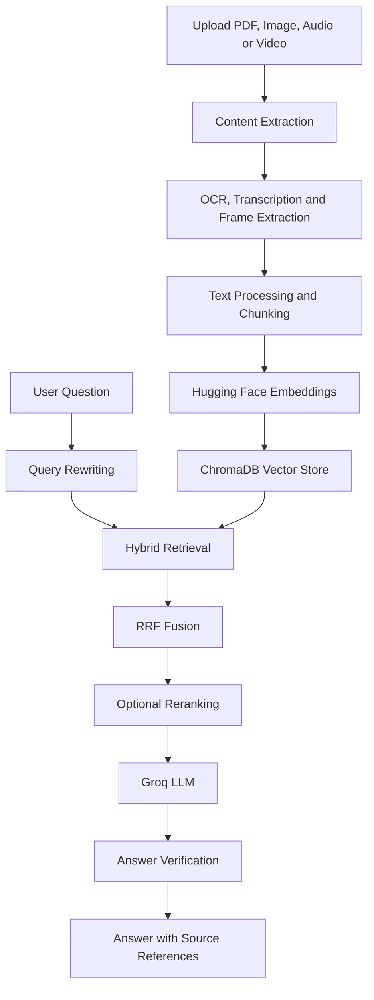

# DocuMind AI – Multimodal RAG Document Assistant

An AI-powered document assistant that allows users to upload different types of files and ask questions about their content using Retrieval-Augmented Generation (RAG).

DocuMind AI processes documents, extracts relevant information, retrieves supporting context, and generates answers with source references through an interactive Streamlit application.

## 🚀 Live Demo

**Application:** https://documind-ai-rag-project.streamlit.app/
## ✨ Features

- **Multi-format Upload:** Supports PDF documents, images, audio files, and video files.
- **PDF Processing:** Extracts text and document content from searchable PDFs.
- **OCR:** Extracts text from scanned PDF documents and images using Tesseract OCR.
- **Image Understanding:** Extracts and interprets information from uploaded images using vision capabilities.
- **Audio Transcription:** Converts audio into text for searching and question answering.
- **Video Understanding:** Extracts video frames and processes spoken content to make video information searchable.
- **Text Chunking:** Splits extracted content into smaller chunks for efficient retrieval.
- **Vector Embeddings:** Converts text chunks into embeddings using Hugging Face sentence-transformer models.
- **Vector Database:** Stores and retrieves document embeddings using ChromaDB.
- **Hybrid Search:** Combines semantic vector search and keyword-based retrieval.
- **Reciprocal Rank Fusion (RRF):** Combines results from different retrieval methods.
- **Optional Reranking:** Improves retrieval relevance using a cross-encoder reranking model.
- **Query Rewriting:** Refines user queries to improve retrieval.
- **Source References:** Provides source information to help users verify generated answers.
- **Answer Verification:** Includes an answer verification step to improve reliability.
- **Interactive Interface:** Provides a Streamlit interface for document upload and conversational querying.
- **RAG Evaluation:** Includes an evaluation script to inspect retrieval performance.

## 🛠️ Tech Stack

| Category | Technologies |
|---|---|
| Programming Language | Python |
| UI Framework | Streamlit |
| LLM | Groq |
| LLM Framework | LangChain |
| Embeddings | Hugging Face Sentence Transformers |
| Vector Database | ChromaDB |
| Document Processing | PyMuPDF |
| OCR | Tesseract OCR |
| Audio Processing | Whisper |
| Video Processing | FFmpeg |
| Retrieval | Dense Search, BM25, RRF |
| Reranking | Cross-Encoder |
| Version Control | Git and GitHub |

## 🏗️ System Architecture



## ⚙️ Project Workflow

1. The user uploads one or more supported files.
2. The application extracts text and relevant content from the files.
3. OCR, audio transcription, and video frame extraction are used where required.
4. Extracted content is split into smaller chunks.
5. Hugging Face embedding models convert the text chunks into vector representations.
6. ChromaDB stores the embeddings for retrieval.
7. A user submits a natural-language question.
8. The application retrieves relevant information using semantic and keyword-based search.
9. Retrieved results are combined using Reciprocal Rank Fusion.
10. Optional reranking improves the ordering of retrieved chunks.
11. Groq LLM generates an answer using the retrieved context.
12. Source information is displayed to support answer verification.

## 📂 Project Structure

```text
DocuMind-AI/
│
├── app.py
├── rag_engine.py
├── evaluate_rag.py
├── make_user_hash.py
│
├── requirements.txt
├── requirements-eval.txt
├── packages.txt
├── .env.example
├── .gitignore
├── README.md
│
├── tests/
├── evaluation/
│
└── .streamlit/
    └── config.toml
```

Some optional files and folders may be absent depending on your project configuration.

## 💻 Installation and Setup

### 1. Clone the repository

```bash
git clone https://github.com/saiv25/DocuMind-AI.git
cd DocuMind-AI
```

### 2. Create a virtual environment

**Windows PowerShell:**

```powershell
python -m venv .venv
.venv\Scripts\Activate.ps1
```

### 3. Install dependencies

```bash
python -m pip install --upgrade pip
pip install -r requirements.txt
```

### 4. Configure environment variables

Create a `.env` file in the project root.

```env
GROQ_API_KEY=your_groq_api_key

OCR_LANG=eng
TESSERACT_CMD=C:/Program Files/Tesseract-OCR/tesseract.exe
TESSDATA_PREFIX=C:/Program Files/Tesseract-OCR/tessdata
```

Add any other environment variables required by your configuration.

**Important:** Never upload your `.env` file or expose your API keys publicly.

### 5. Install system dependencies

Install Tesseract OCR and FFmpeg if they are not already installed on your machine.

### 6. Run the application

```bash
streamlit run app.py
```

The application will open in your browser.

## 🧪 Testing and Evaluation

The application has been tested with multiple file types:

- Searchable PDF extraction
- Scanned PDF OCR
- Image understanding
- Audio transcription
- Video frame and speech processing
- Question answering over uploaded content

Run the evaluation script:

```bash
python evaluate_rag.py
```

Evaluation should be performed using questions with known expected answers and verified source documents.

## 🔐 Environment Variables

| Variable | Purpose |
|---|---|
| `GROQ_API_KEY` | Authenticates requests to Groq |
| `OCR_LANG` | Sets the OCR language |
| `TESSERACT_CMD` | Specifies the Tesseract executable path |
| `TESSDATA_PREFIX` | Specifies the Tesseract language-data directory |

## 🔮 Future Improvements

- Persistent cloud storage for uploaded documents and embeddings.
- User-specific document workspaces and access controls.
- Improved retrieval evaluation using Ragas.
- More advanced multimodal document understanding.
- Support for additional file formats.
- Optimisation for larger document collections.

## 👨‍💻 Author

**Sainath Vangujare**

Computer Engineering Graduate | Python | SQL | Generative AI | RAG Applications

- GitHub: [saiv25](https://github.com/saiv25)

---

**Note:** DocuMind AI is a learning and portfolio project. Generated answers should be checked against the cited source documents, especially for important decisions.